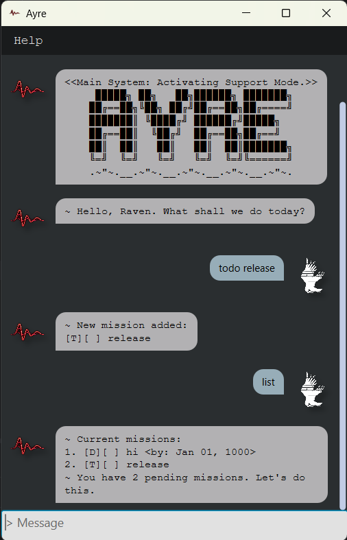

# Ayre User Guide



## Table of contents

- [Quick start](#quick-start)
- [Reading the task list](#reading-the-task-list)
- [Features](#features)
  - [Notes about command format](#notes-about-command-format)
  - [Accessing the help guide](#accessing-the-help-guide)
  - [Adding a todo task: `todo`](#adding-a-todo-task-todo)
  - [Adding a deadline: `deadline`](#adding-a-deadline-deadline)
  - [Adding an event: `event`](#adding-an-event-event)
  - [Listing all tasks: `list`](#listing-all-tasks-list)
  - [Marking a task as done: `mark`](#marking-a-task-as-done-mark)
  - [Marking a task as not done: `unmark`](#marking-a-task-as-not-done-unmark)
  - [Deleting a task: `delete`](#deleting-a-task-delete)
  - [Finding tasks: `find`](#finding-tasks-find)
  - [Exiting Ayre: `bye`](#exiting-ayre-bye)
- [Accessing the save file](#accessing-the-save-file)
  - [Editing the save file](#editing-the-save-file)
- [Command summary](#command-summary)

## Quick start

1. Ensure that Java 25 or later is installed on your computer.
2. Download `Ayre.jar` from the [latest release](https://github.com/zRayhhh/ip/releases/tag/v0.2-beta).
3. Copy `Ayre.jar` into a folder of your choice.
4. Launch Ayre by double-clicking the JAR file, or run `java -jar "Ayre.jar"` from a terminal.
5. Type commands into the message box and press **Enter**.

To try a simple use case, add a task, view it, and mark it as complete:

```text
todo Read the user guide
list
mark 1
```

Ayre saves your tasks automatically and restores them the next time you launch the application.

## Reading the task list

Tasks use this format:

```text
index. [type][status] description [date information]
```

`[T]`, `[D]`, and `[E]` identify todo, deadline, and event tasks respectively. `[ ]` means pending and `[+]` means complete. The index is the task index used by `mark`, `unmark`, and `delete`.

For example:

```text
1. [T][ ] Read the user guide
2. [D][+] Submit assignment <by: Sep 20, 2026>
3. [E][ ] Project meeting <from: Sep 18, 2026 to: Sep 18, 2026>
```

In the example, task 2 is a completed deadline, while task 3 is a pending event. Enter dates in ISO local date format `yyyy-mm-dd`, such as `2026-09-20`.

## Features

> **Command format notes**
> - Words in `UPPER_CASE` are placeholders that you replace with your own values. For example, replace `DESCRIPTION` with `Read the user guide`.
> - A `DESCRIPTION` may contain spaces.
> - Command formats should be followed strictly. Whitespace immediately before or after command flags like `todo` or `/by` will be ignored.
> - `INDEX` refers to the task index as shown by `list`. It is an index starting from 1.
> - `DATE`, `START_DATE`, and `END_DATE` must use the `yyyy-mm-dd` format.
> - All command flags have their equivalent shorthands that can be used interchangeably.

### Accessing the user guide within the app

From the Ayre window, open the **Help** menu and select **User Guide** to open the in-app help guide.

### Adding a todo task: `todo`

Adds a task without a date.

Format: `todo DESCRIPTION`

Shorthand: `t DESCRIPTION`

Example: `todo Read the user guide`

### Adding a deadline: `deadline`

Adds a task with a due date. The date must be possible.

Format: `deadline DESCRIPTION /by DATE`

Shorthand: `d DESCRIPTION /b DATE`

Example: `deadline Submit assignment /by 2026-09-20`

### Adding an event: `event`

Adds a task with a start date and an end date. The dates must be possible, and END_DATE must be later than or equal to START_DATE.

Format: `event DESCRIPTION /from START_DATE /to END_DATE`

Shorthand: `e DESCRIPTION /f START_DATE /t END_DATE`

Example: `event Project meeting /from 2026-09-18 /to 2026-09-18`

### Listing all tasks: `list`

Shows all tasks in the task list.

Format: `list`

Shorthand: `l`

### Marking a task as done: `mark`

Marks the task at the specified index in the list as complete. Re-marking a completed task does nothing.

Format: `mark INDEX`

Shorthand: `m INDEX`

Example: `mark 1`

### Marking a task as not done: `unmark`

Marks the task at the specified index in the list as pending. Unmarking a pending task does nothing.

Format: `unmark INDEX`

Shorthand: `u INDEX`

Example: `unmark 1`

### Deleting a task: `delete`

Deletes the task at the specified index in the list. This may change the index index of other tasks in the list.

Format: `delete INDEX`

Shorthand: `rm INDEX`

Example: `delete 2`

### Finding tasks: `find`

Finds and lists tasks whose descriptions contain the specified keyword. The search is case-insensitive.

Format: `find KEYWORD`

Shorthand: `f KEYWORD`

Example: `find assignment`

### Exiting Ayre: `bye`

Exits the application.

Format: `bye`

Shorthand: `b`

## Accessing the save file

Ayre saves task data automatically in `data/ayre.txt`, relative to the folder where Ayre is launched. Each task occupies one line with fields separated by whitespace:

```text
TASK_TYPE STATUS DESCRIPTION [DATE] [DATE]
```

- `TASK_TYPE` is `T` for a todo, `D` for a deadline, or `E` for an event.
- `STATUS` is `0` for pending or `1` for complete.
- `DESCRIPTION` is the task description.
- Dates use `yyyy-mm-dd` and are included according to the task type: todo records have no dates, deadlines have one date, and events have two dates.

  | Task type | Example Save-file format                      |
  | --- |-----------------------------------------------|
  | Todo | `T 0 This is a todo`                          |
  | Deadline | `D 1 This is a completed deadline 2006-06-06` |
  | Event | `E 0 This is an event 2005-05-05 2006-06-06`  |

### Editing the save file

Any edits made while Ayre is open will not be saved. 
 
Close Ayre first, then open `data/ayre.txt` in a text editor to make your edits. Follow the given format (including whitespace) strictly, and ensure that the dates are valid. Malformed records are removed when launching Ayre.

## Command summary

| Command                                           | Shorthand                                 | Description                                        |
|---------------------------------------------------|-------------------------------------------|----------------------------------------------------|
| `todo DESCRIPTION`                                | `t DESCRIPTION`                           | Add a todo task.                                   |
| `deadline DESCRIPTION /by DATE`                   | `d DESCRIPTION /b DATE`                   | Add a task with a deadline.                        |
| `event DESCRIPTION /from START_DATE /to END_DATE` | `e DESCRIPTION /f START_DATE /t END_DATE` | Add a task with a start and end date.              |
| `list`                                            | `l`                                       | Show all tasks.                                    |
| `mark INDEX`                                    | `m INDEX`                               | Mark a task as done.                               |
| `unmark INDEX`                                  | `u INDEX`                               | Mark a task as not done.                           |
| `delete INDEX`                                  | `rm INDEX`                              | Delete a task.                                     |
| `find <keyword>`                                  | `f <keyword>`                             | Find tasks which descriptions contain the keyword. |
| `bye`                                             | `b`                                       | Exit Ayre.                                         |
